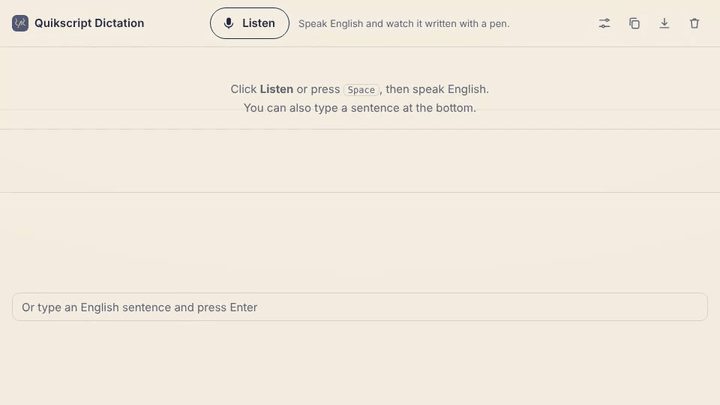
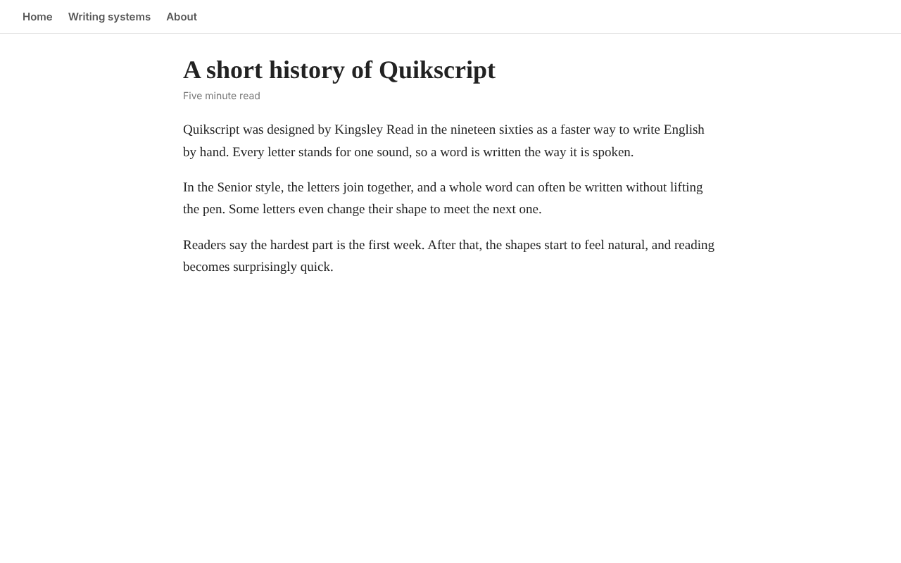
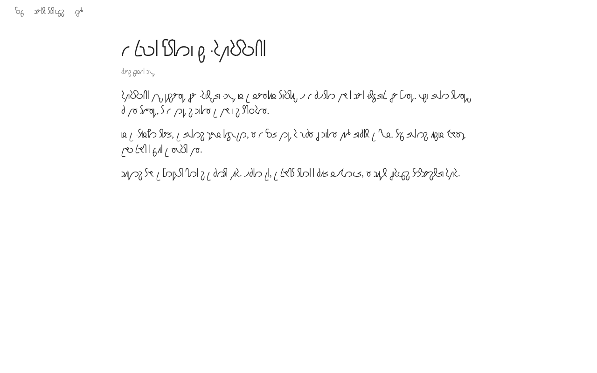
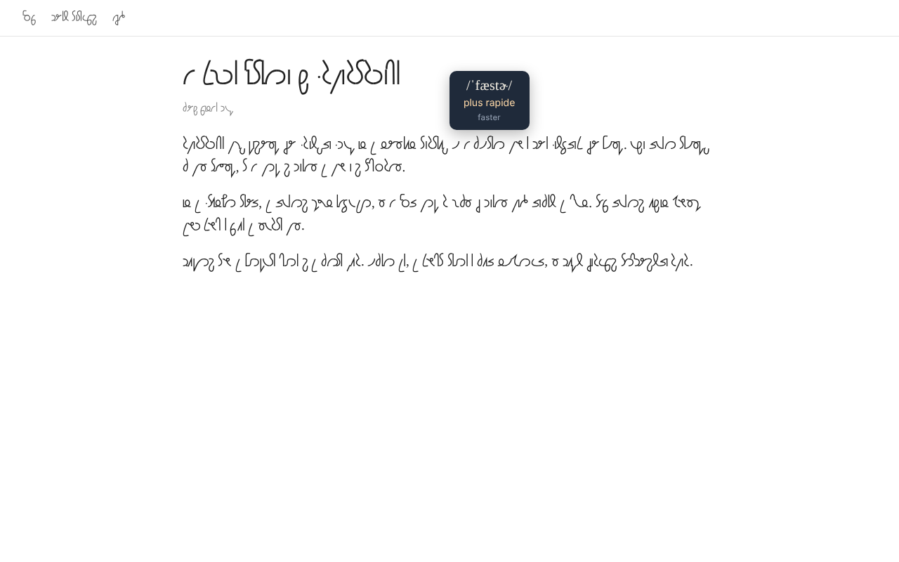
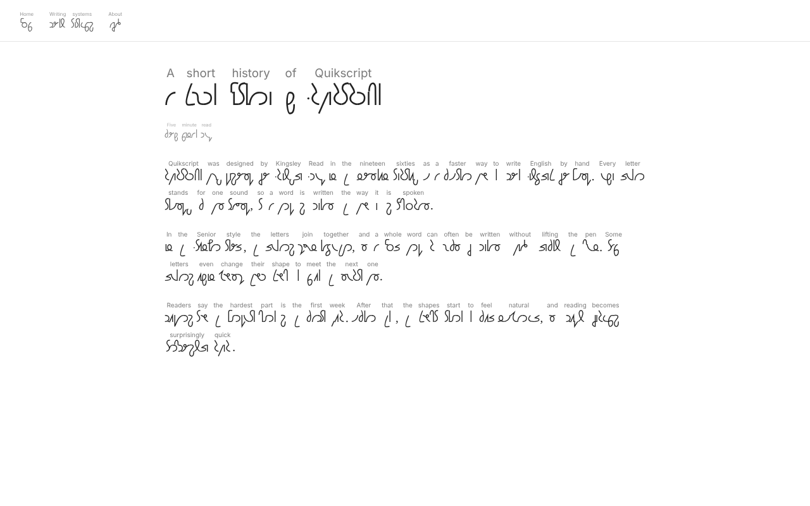

# Quikscript Reader

A Chrome extension for reading and writing [Quikscript](https://www.quikscript.net/), Kingsley Read's phonetic alphabet for English.

- **Alt+Q** (Option+Q on a Mac) rewrites any English web page in **joined Senior Quikscript**, and switches back.
- **Hover a word** to see its American pronunciation in IPA, a translation and the English word.
- **Dictation** (Alt+Shift+Q): speak English and watch the words being written with a pen, stroke by stroke, across the joins.

| A page in English | The same page in Senior Quikscript |
| --- | --- |
|  |  |

| Hover card | English above each word |
| --- | --- |
|  |  |

## Install

1. Download `quikscript-reader-<version>.zip` from the [latest release](../../releases/latest) and unzip it somewhere it can stay.
2. Open `chrome://extensions` and turn on **Developer mode** (top right).
3. Click **Load unpacked** and pick the unzipped `quikscript-reader` folder (the one that contains `manifest.json`).
4. Pin the extension from the puzzle icon in the toolbar.

You can also clone this repository and load the `extension` folder directly.

To update, replace the folder and click the reload arrow on Quikscript Reader in `chrome://extensions`.

## Using it

| Shortcut | What it does |
| --- | --- |
| Alt+Q (Option+Q) | Switch the current page to Quikscript, and back to English |
| Alt+Shift+Q (Option+Shift+Q) | Open the dictation page |

Shortcuts can be changed in `chrome://extensions/shortcuts`.

The popup has the rest of the settings: Senior (joined) or Junior (separate letters), size, what the hover card shows, the translation language, English above each word, and an option to write pages with the pen when they switch to Quikscript.

**Translation** uses Chrome's built-in, on-device translator (Chrome 138 or later, desktop). Pick the language in the popup and click **Download** once to install that language model. French is the default.

**Dictation** uses Chrome's speech recognition (American English). Chrome asks for the microphone the first time. You can also type a sentence at the bottom of the page. The buttons at the top right copy the English, download the page as an image, or clear it.

## How it writes Senior

Each word goes through three steps.

1. **Sounds.** American pronunciations come from the CMU Pronouncing Dictionary and are turned into Quikscript letters, with the Manual's Senior shortcuts (*the*, *of*, *and*…). Words missing from the dictionary are guessed with the NRL letter-to-sound rules. Capitalised words in the middle of a sentence get a namer dot.
2. **Joins.** For every letter, the engine picks the form (No looped or flipped, half letters, the alternate Utter, ligatures…) that lets the most letters join, following the rules of the Quikscript Manual as transcribed in Nathan Galt's [Abbots Morton Spaceport](https://github.com/adiabatic/abbots-morton-spaceport) glyph data. It is a small Viterbi search over each letter's entry and exit heights.
3. **Drawing.** Letters are drawn with the outlines of Nathan Galt's [Abbots Morton Experiment](https://github.com/adiabatic/abbots-morton-experiment) font. Ten Senior ligatures it doesn't have (They, Way, Why, Vie, See, Jay and J'ai + Utter, Out + Tea, Day + Eat, See + Eat) are drawn to match it.

On the 659 example words from the Manual that Spaceport uses for its tests, **93%** come out exactly as Read writes them and **96.5%** of the joins match.

**Writing with the pen.** For every outline, `tools/pen_paths.py` thins the shape to its centre line, turns it into a graph and computes the order a pen would follow (straight through crossings, out and back on sharp corners), oriented with the description of each letter's motion in Spaceport. The page then reveals the ink along that path with an SVG mask.

## Known limitations

- A few variant shapes (some forms of See, Vie, Ye, I, Eight, Fee, At) are drawn with the letter's base shape.
- Tea + Oy and They + Zoo have no ligature yet.
- The pen direction of some letters is a best guess.
- Words not in the dictionary, often names, can be transcribed wrongly.
- Chrome doesn't let extensions change `chrome://` pages, the Chrome Web Store or PDFs.

Corrections from people who write Senior well are very welcome: open an issue with the word, what the extension writes and what you would write.

## Privacy

Quikscript Reader collects nothing and sends nothing anywhere. Transcription, drawing and translation run on your computer. The only exception is Chrome's own speech recognition on the dictation page, which may send audio to Google to recognise it. See [PRIVACY.md](PRIVACY.md).

## Repository layout

- `extension/`: the extension itself (load this folder, or the zip from the releases).
- `tools/`: the scripts used to build the data in `extension/data/` (joining rules, ligature outlines, pen paths, dictionaries) and to score the engine against the Manual's examples.
- `docs/`: screenshots.

## Credits

- Quikscript was devised by **Kingsley Read** (1887-1975).
- Joining rules: **Abbots Morton Spaceport** glyph data by Nathan Galt (MIT License).
- Letter outlines: **Abbots Morton Experiment** by Nathan Galt (Apache License 2.0).
- Pronunciations: **CMU Pronouncing Dictionary** (Carnegie Mellon University, BSD-style license).
- Letter-to-sound rules for unknown words: **NRL rules** (public domain).
- Code written with Claude.

Third-party licences are in [`extension/licenses`](extension/licenses). The extension's own code is under the [MIT License](LICENSE).
